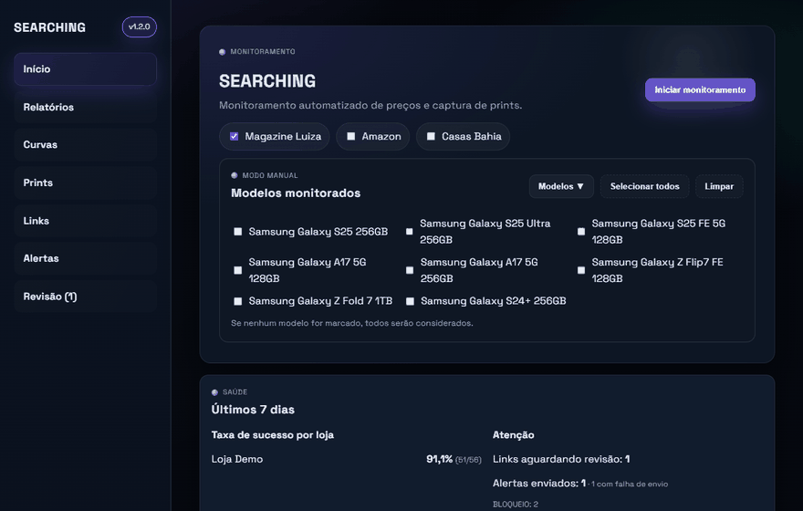
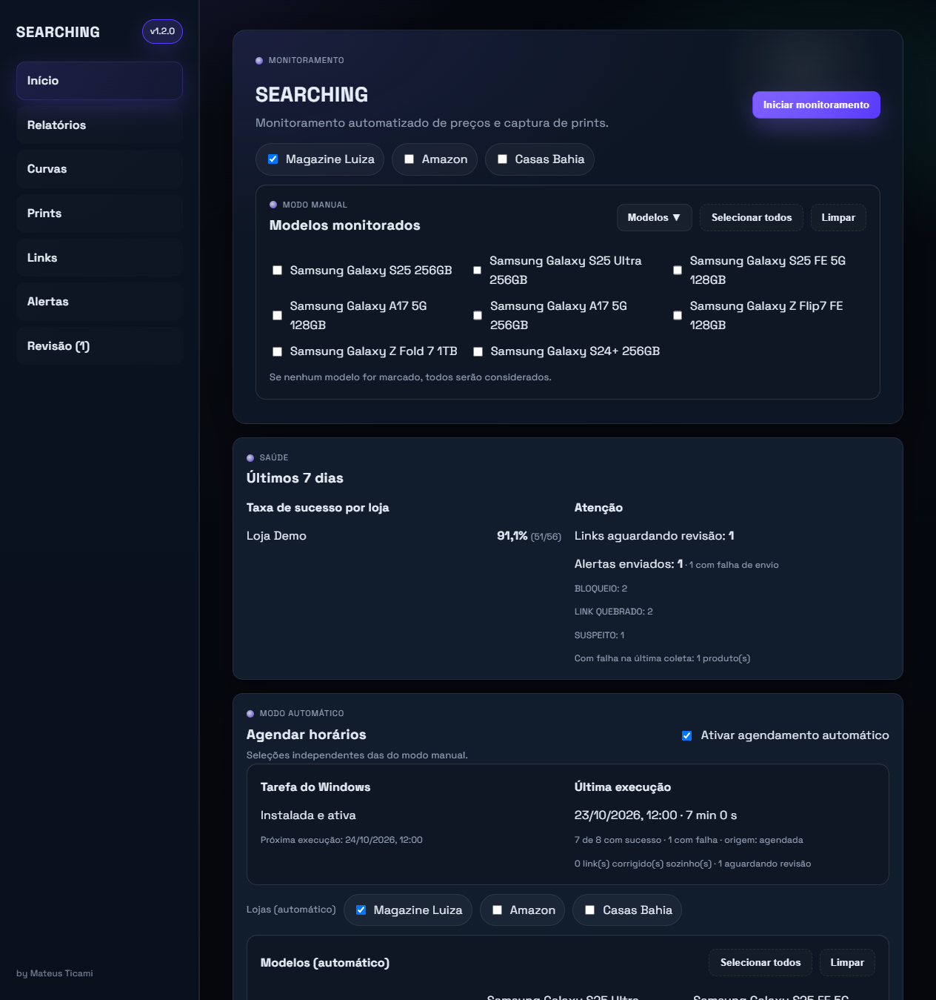
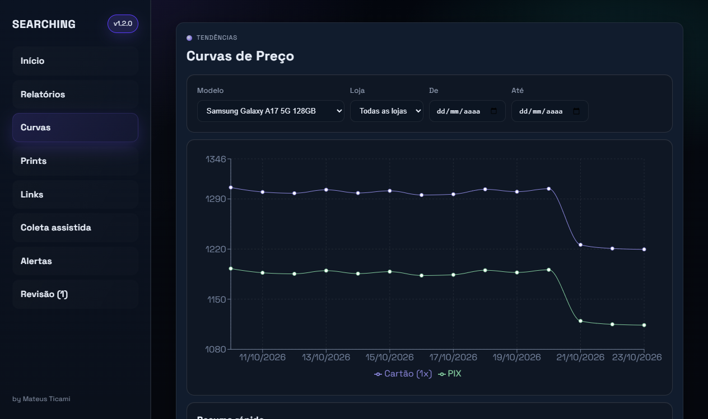
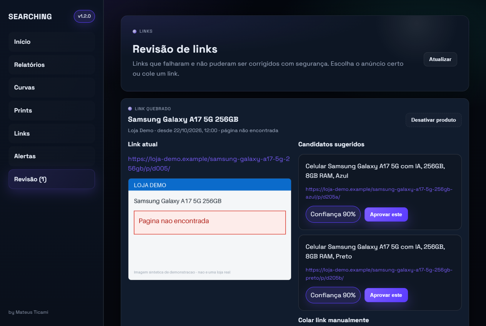
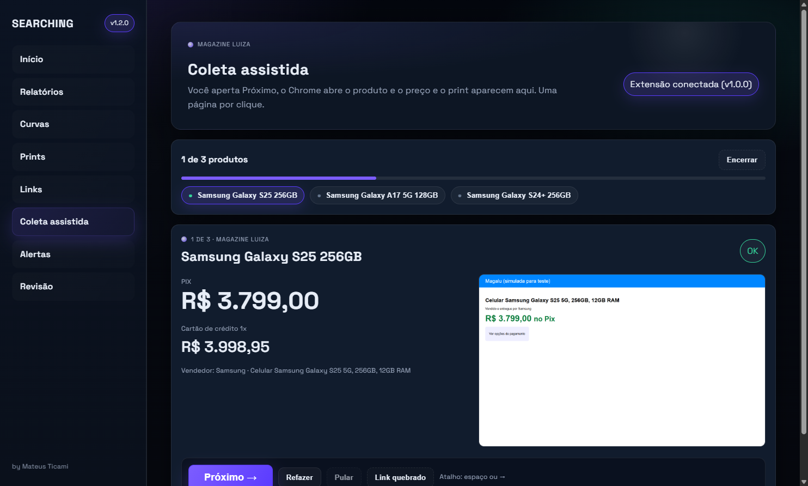
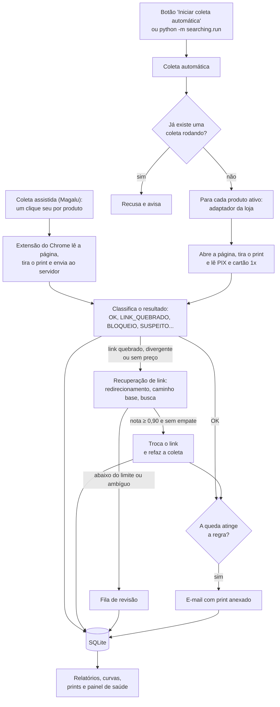

# SEARCHING

Monitor de preços com **evidência em print**. Abre o link de cada produto nas lojas, lê os preços, guarda uma foto da página no momento da coleta e avisa por e-mail quando o preço cai.



> As imagens deste repositório usam **dados fictícios** de uma "Loja Demo" (veja [Demonstração](#demonstração-sem-depender-de-nenhuma-loja)). Nenhum dado, preço ou print real é publicado.

## O problema

Em um contexto de pricing era preciso acompanhar o preço de celulares em lojas concorrentes e **guardar prova visual da página**, algo que a solução terceirizada não entregava. Fazer isso à mão não escala, e as coletas automáticas tendem a falhar em silêncio: o anúncio muda de endereço, a página muda de layout e o dado sai vazio sem ninguém perceber.

O SEARCHING resolve a coleta e, principalmente, a **confiabilidade**:

- cada coleta recebe um status explícito, e **nunca há `OK` sem um preço válido**;
- links quebrados são **recuperados automaticamente**, mas só quando há certeza de que é o mesmo produto;
- o que foge do esperado (preço 40% diferente, página de bloqueio, produto trocado) é marcado e **não gera alerta falso**;
- todo resultado, bom ou ruim, fica registrado, com o print da página.

## O que ele faz

| | |
|---|---|
| **Coleta** | Um adaptador por loja lê título, vendedor, preço PIX e preço no cartão 1x; tira o print pelo próprio navegador; faz até 2 retentativas com espera crescente e pausas entre as páginas. |
| **Status** | `OK`, `LINK_QUEBRADO`, `PRODUTO_DIVERGENTE`, `PRECO_NAO_ENCONTRADO`, `INDISPONIVEL`, `TIMEOUT`, `BLOQUEIO`, `ERRO_INESPERADO` e `SUSPEITO`. |
| **Recuperação de links** | Redirecionamento, caminho base do produto e busca da loja, com **nota de confiança** e regras duras para nunca trocar de variante. O que não passa vai para a fila de **Revisão**. |
| **Coleta assistida** | Para lojas que bloqueiam robôs: uma extensão do Chrome lê a página que **você** abre (um clique por produto) e envia preço PIX, cartão 1x e print ao sistema. |
| **Alertas** | E-mail com preço anterior e atual, percentual, link e o **print anexado**. Sem repetir o mesmo preço. |
| **Relatórios** | Histórico filtrável, curvas de preço, galeria de prints com o preço ao lado, exportação para Excel e painel de saúde. |

## Capturas de tela

| Início (como funciona, resumo e próximas ações) | Curvas de preço |
|---|---|
|  |  |

**Revisão de links** (links que não puderam ser corrigidos com segurança, com o print da falha e candidatos):



**Coleta assistida** (o resultado preenche sozinho enquanto você aperta Próximo; a imagem vem do teste ponta a ponta, com uma loja simulada):



## Como funciona



### Estrutura

```
backend/searching/
  adapters/      um módulo por loja (base.py = contrato, magalu.py = seletores e textos da loja)
  core/          coleta, status, validação do título, preços, trava de execução simultânea
  links/         recuperação de links: estratégias e nota de confiança
  alerts/        regras de queda, e-mail (SMTP) e modelos HTML
  db/            modelos SQLAlchemy, links com histórico, migração dos CSVs antigos
  run.py         ponto de entrada da coleta (CLI)
  relatorios.py  consultas dos relatórios, Excel e painel de saúde
  seguranca.py   proteções do servidor local
backend/server.py   API Flask (só lê/grava o banco e dispara o CLI)
backend/tests/      mais de 200 testes (pytest), com páginas HTML salvas como fixtures
frontend/           React + Vite
extensao/           extensão do Chrome da coleta assistida (Manifest V3)
scripts/            demonstração, teste ponta a ponta e geração das imagens deste README
```

## Instalação e uso (Windows)

Requisitos: **Python 3.11+**, **Node.js 18+** e **Google Chrome**.

```bash
iniciar_searching.bat
```

A tela **Início** explica como o sistema funciona, mostra o resumo dos últimos 7 dias e sugere o que fazer agora. O script cria o ambiente virtual do backend, instala as dependências, sobe o servidor Flask e o frontend e abre http://localhost:5173. Cadastre os produtos na tela **Links**. Se você vem da versão antiga (com `links.csv` e `historico.csv`), `python -m searching.db.migracao_csv` (executado a partir de `backend/`) importa tudo, e a primeira coleta faz o mesmo quando o banco ainda está vazio. A importação é idempotente.

### Coleta pela linha de comando

```bash
cd backend
python -m searching.run                                     # todos os produtos ativos
python -m searching.run --loja magalu                        # só uma loja
python -m searching.run --incluir "Samsung Galaxy S25 256GB"
```

O resumo sai em JSON na última linha, o log fica em `backend/logs/searching.log` (com rotação) e os prints em `backend/prints/AAAA-MM-DD/`. Só uma coleta roda por vez.

### Coleta assistida (para lojas que bloqueiam robôs)

Algumas lojas, como a Magazine Luiza, recusam navegador controlado por programa. Para elas há a **coleta assistida**: você abre cada produto no seu Chrome de sempre, com um clique por produto, e uma extensão envia preço, cartão 1x e print ao sistema.

1. Instale a extensão uma vez (`chrome://extensions`, Modo do desenvolvedor, **Carregar sem compactação**, pasta `extensao`). Veja [extensao/README.md](extensao/README.md).
2. Abra a tela **Coleta assistida**, clique em **Começar** e arraste a janela da loja para o outro monitor.
3. A cada **Próximo** (ou espaço, ou →) o produto abre e o resultado aparece preenchido. Há também Refazer, Pular e Link quebrado.
4. Se algum produto sair com erro (qualquer status diferente de `OK`, inclusive `SUSPEITO`), um **aviso amarelo fixo no topo** mostra a contagem ("⚠ 3 produtos com erro"). Ao abri-lo, cada produto aparece com o motivo e um botão **Refazer**. O aviso acompanha você pela fila e some quando não há mais erro pendente.

**Um clique por página, de propósito.** Não existe um botão "Coletar tudo" que abra os produtos sozinho com pausas aleatórias: numa loja que bloqueia acesso automatizado, isso seria automatizar a navegação num contexto que ela não detecta, ou seja, driblar o bloqueio. Aqui a decisão de abrir cada página é sua. Para volume sem cliques, os caminhos são a coleta automática nas lojas que a permitem e, na Magalu, um canal oficial.

Tudo o que vem depois é igual à coleta automática: validação de título, status, preço suspeito, alertas por e-mail com o print e relatórios. Intervalo mínimo de 3 segundos entre páginas, uma página por clique.

### Alertas por e-mail

1. Copie `.env.example` para `.env` (na raiz; o arquivo nunca vai para o Git) e preencha. No Gmail, ative a verificação em duas etapas e crie uma **senha de app** em https://myaccount.google.com/apppasswords.
2. Abra a tela **Alertas** e use "Enviar e-mail de teste".

Regras (padrão global, com exceções por produto): queda mínima (5%), comparação com o último preço, o menor ou a média dos últimos N dias, base PIX ou cartão 1x e preço-alvo opcional. O mesmo preço nunca é avisado duas vezes: um novo aviso exige cair mais um degrau (2%) ou o preço subir e voltar a cair. Se o envio falhar, o alerta fica registrado e é reenviado na coleta seguinte. Um e-mail de resumo ao fim de cada coleta é opcional.

### Demonstração, sem depender de nenhuma loja

```bash
scripts\iniciar_demo.bat
```

Gera 14 dias de histórico fictício (preços, quedas, bloqueios, um link corrigido sozinho, um em revisão, alertas e prints sintéticos) num banco separado e abre a interface. Os seus dados reais não são lidos nem alterados. Para refazer as imagens deste README: `cd backend && python ..\scripts\gerar_docs.py`.

### Variáveis de ambiente (opcionais)

| Variável | Efeito |
|---|---|
| `SEARCHING_DB` | Caminho do banco SQLite (padrão: `backend/data/searching.db`). |
| `SEARCHING_PRINTS` | Pasta dos prints (padrão: `backend/prints`). |
| `SEARCHING_PORT` | Porta do servidor (padrão: 5000). |
| `SEARCHING_DEBUG=1` | Liga o modo debug, só para desenvolvimento. |
| `SEARCHING_ORIGENS` | Origens locais extras permitidas no CORS, por exemplo `http://localhost:3000`. |

O servidor sempre escuta apenas em `127.0.0.1`; `SEARCHING_HOST` com outro valor é ignorado.

### Modo hospedado (várias pessoas, com login)

Por padrão tudo é **local**: sem login, só `127.0.0.1`. Com `SEARCHING_MODO=hospedado` o sistema vira multiusuário
(desenho completo em [`docs/DESENHO_MULTIUSUARIO.md`](docs/DESENHO_MULTIUSUARIO.md)):

- **Contas e papéis** validados no servidor (deny by default): `admin` (tudo), `coletor` (coleta assistida e edita o que lhe foi atribuído) e `leitor` (só vê).
- **A coleta continua no computador de cada pessoa**, pela extensão do Chrome/Edge: o servidor hospedado nunca abre lojas (a coleta automática fica bloqueada nesse modo, até para o admin).
- Senhas com Argon2id, cookie de sessão `HttpOnly`/`Secure`/`SameSite`, CSRF, bloqueio por tentativas, recuperação de senha por e-mail, 2FA opcional e log de auditoria.
- Primeiro administrador, sem senha padrão: `cd backend && python -m searching.usuarios criar-admin --email voce@exemplo.com`.

| Variável (modo hospedado) | Efeito |
|---|---|
| `SEARCHING_MODO=hospedado` | Liga login, papéis e auditoria. |
| `SEARCHING_URL_PUBLICA` | Endereço HTTPS do site (obrigatório), por exemplo `https://searching.suaempresa.com`. |
| `SEARCHING_PROXIES=1` | Quantidade de proxies reversos confiáveis à frente (lê `X-Forwarded-*`). |

### Testes

```bash
cd backend
pip install -r requirements-dev.txt
pytest
```

Os testes cobrem o parser de preços, a classificação de status, as regras de alerta, a nota de confiança dos links, a recuperação com lojas falsas, o e-mail (sem enviar nada), a migração, a API e as proteções de segurança. Os adaptadores são testados com páginas HTML salvas, sem abrir navegador.

## Decisões técnicas

**SQLite no lugar de CSV.** O projeto começou com `links.csv` e `historico.csv`: preços em texto (`R$ 3.167 , 12`), sem validação e com status `OK` mesmo com o preço vazio. O SQLite (arquivo único, sem servidor, ótimo para uso local) permite guardar o preço **em centavos, como número**, o texto bruto lido da página para auditoria, histórico de trocas de link e consultas de verdade. Uma migração idempotente importa os CSVs antigos, e as linhas `OK` sem preço viram `PRECO_NAO_ENCONTRADO`.

**Adaptadores por loja.** Seletores e textos de cada loja ficam isolados em um módulo que implementa um contrato único (abrir, ler título/vendedor/preços, ler cartão 1x, buscar). Quando o layout muda, só o adaptador muda. Adicionar uma loja não mexe no fluxo principal, e a leitura da página é uma função pura, testável com HTML salvo.

**Nota de confiança que não troca de produto errado.** Ao recuperar um link, cada candidato passa por **regras duras**: marca, modelo, armazenamento e variantes (`FE`, `Ultra`, `Edge`, `+`) precisam bater. Candidato que viola alguma recebe nota 0, então um S25 nunca vira S25 Ultra e um A17 de 128 GB nunca vira o de 256 GB. Depois disso, a nota sobe com título idêntico ao cadastro e com o mesmo código de produto. A troca automática exige nota ≥ 0,90, página aberta com preço e **nenhum rival quase empatado** (duas cores do mesmo modelo viram revisão humana, não um palpite).

**Coleta como comando, separado do servidor.** `python -m searching.run` não depende da interface aberta, e o botão da tela chama o mesmo comando. O Flask só expõe a API e lê o banco. Como é um comando comum, qualquer agendador seu (Agendador de Tarefas, cron) pode chamá-lo.

**Print pelo navegador.** O screenshot vem do próprio driver (`save_screenshot`), não da tela do Windows. Não importa se outra janela está na frente ou se a tela está bloqueada.

**Comportamento educado com as lojas.** Pausa entre páginas, retentativas com espera crescente e, depois de dois bloqueios seguidos numa loja, o resto dela é registrado como `BLOQUEIO` **sem novas requisições**.

**Segurança de um servidor local.** Só escuta em `127.0.0.1`, sem modo debug, CORS restrito ao frontend, recusa `Host` forjado (DNS rebinding) e escritas com `Origin` de outros sites (CSRF). As credenciais ficam só no `.env`.

## Limitações conhecidas

- **Anti-bot.** A Magazine Luiza bloqueia acessos automatizados (o servidor responde "Erro 403" mesmo para um navegador controlado por Selenium, no mesmo computador onde a página abre normalmente à mão). A coleta automática registra o `BLOQUEIO` com o print da página de erro e segue, **sem tentar contornar**. Para a Magalu existe a **coleta assistida** (um clique humano por produto), que não escala para centenas de produtos. Para volume e uso contínuo o caminho correto é um canal oficial (API de marketplace ou de afiliados, ou um acordo de dados). Por isso o repositório traz também a demonstração com dados fictícios.
- **Coleta assistida testada com loja simulada.** O fluxo completo (extensão, tela, servidor, print, cartão 1x) é testado ponta a ponta com Chrome real contra uma loja simulada. Os seletores da Magalu real, em especial o menu de pagamento, ainda precisam ser confirmados em uso.
- **Só a Magazine Luiza tem adaptador.** Amazon e Casas Bahia são reconhecidas pelo domínio, mas não coletadas.
- **Seletores da busca não validados ao vivo.** A leitura de preços e a busca da Magalu foram escritas a partir do código original e testadas com HTML salvo; como a loja estava bloqueando, não foram conferidas contra a página real nesta versão.
- **Windows.** Os scripts de inicialização são `.bat`, e a coleta automática abre o Chrome visível.
- **Sem login.** Quem usa o computador usa o sistema.
- **Histórico migrado.** Os dados anteriores à versão atual vêm de coletas que gravavam `OK` mesmo sem preço; esses casos foram reclassificados.

## Próximos passos

- Adaptadores da Amazon e das Casas Bahia, e avaliar migrar para Playwright (esperas automáticas e screenshot nativo).
- Alertas de alta de preço e de volta ao estoque.
- Edição dos destinatários dos alertas pela interface.
- Tela para o histórico de trocas de link (a API de reversão já existe).
- Login opcional validado pelo backend, para quem compartilha o computador.

## Uso responsável

Projeto pessoal e demonstrativo, com ritmo baixo de requisições. Respeite os termos de uso e o `robots.txt` de cada loja, e não tente contornar captchas ou bloqueios.
